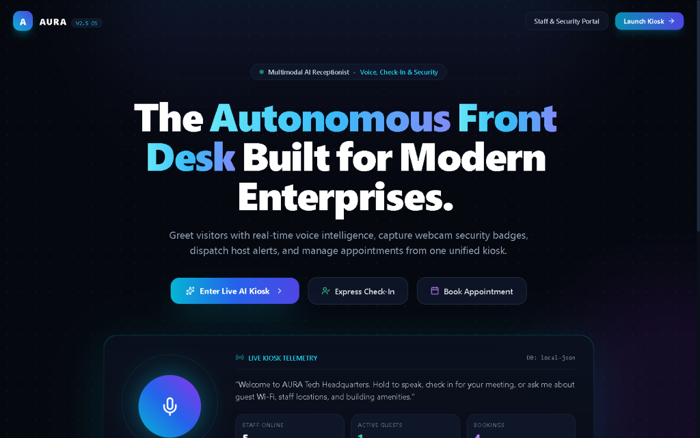
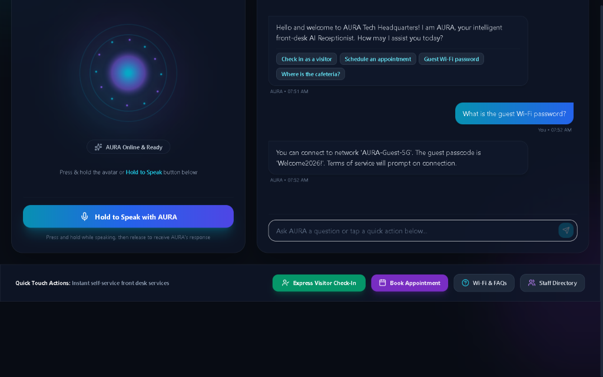
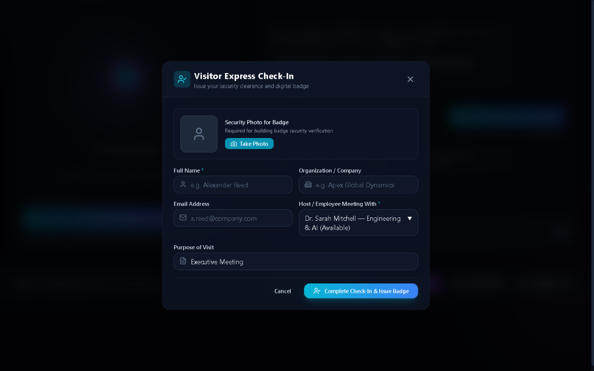
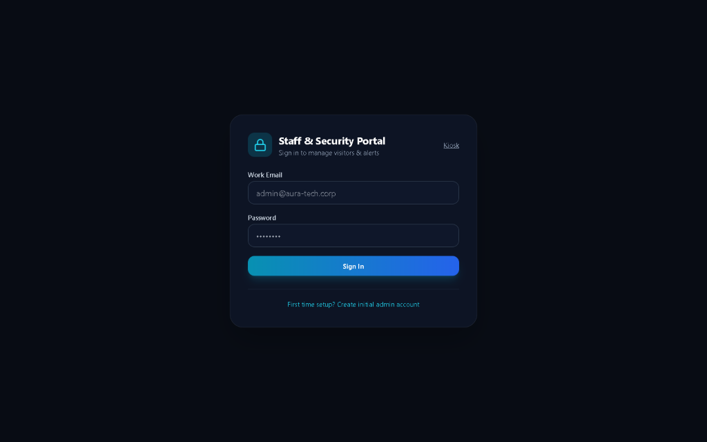
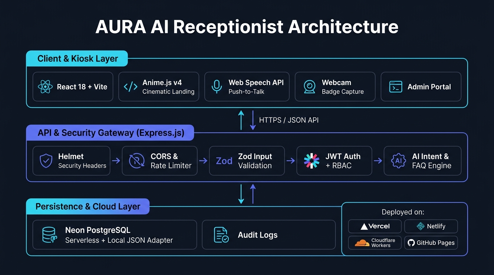

# AURA AI Receptionist

> **Autonomous multimodal front-desk intelligence for modern enterprises.**

[](https://aura-ai-receptionist-black.vercel.app)
[](https://github.com/kalyan870/aura-ai-receptionist/actions/workflows/ci.yml)
[](LICENSE)

AURA AI Receptionist is a full-stack front-desk kiosk and visitor-security platform that greets guests with real-time push-to-talk voice AI, captures webcam security badges, books conflict-free appointments, dispatches 2-way host alerts, and enforces role-based access control backed by Neon PostgreSQL.

**[Open the live application →](https://aura-ai-receptionist-black.vercel.app)** · **[Netlify →](https://aura-ai-receptionist-kalyan.netlify.app)** · **[Cloudflare →](https://aura-ai-receptionist.saragadamkalyan068-fdc.workers.dev)** · **[GitHub Pages →](https://kalyan870.github.io/aura-ai-receptionist/)**

## Portfolio highlights

- Built a **multimodal kiosk UI** with an **Anime.js v4** choreographed cinematic landing page, live telemetry stage, and a Canvas holographic avatar visualizer (`Idle`, `Listening`, `Thinking`, `Speaking`).
- Implemented **Hold-to-Speak (Push-to-Talk)** continuous voice recognition with live interim transcripts and browser Speech Synthesis responses.
- Engineered a **zero-trust Express.js backend** with `scrypt` salted password hashing, `timingSafeEqual` verification, JWT authentication, and 3-tier Role-Based Access Control (`admin`, `staff`, `security`).
- Designed a **Neon PostgreSQL** relational schema (`staff`, `users`, `visitors`, `appointments`, `notifications`, `faqs`, `audit_logs`) with partial unique indexes to prevent double-booking and parameterized queries via `@neondatabase/serverless`.
- Hardened all endpoints with **Zod** schema validation, XSS payload sanitization, `helmet` security headers, sliding-window rate limiting, and strict CORS.


## What it delivers

- **Cinematic Landing & Live Telemetry**: Animated spotlight hero, live `/api/status` counters, and 6-card Bento capability showcase.
- **Hold-to-Speak AI Concierge**: Answers office FAQs (guest Wi-Fi, cafeteria, parking, restrooms), looks up staff availability/rooms, and triggers kiosk modals autonomously.
- **Express Visitor Check-In & QR Badges**: Live webcam snapshot capture, host selection, automatic host arrival alert, and printable visitor badge with SVG QR code.
- **Conflict-Free Appointment Scheduling**: Date/time-slot picker with server-side conflict detection (`409 Conflict`).
- **Staff & Security Admin Portal**: JWT-protected dashboard with live visitor logs, one-click check-out, 2-way host replies, staff status toggles, and printable Emergency Evacuation Muster Roll.


## Live Output Screenshots

### 1. Cinematic Landing & Live Telemetry


### 2. Interactive AI Kiosk & Voice Dialogue


### 3. Express Visitor Check-In & Webcam Badge Capture


### 4. Staff & Security Portal (JWT Authentication)



## Complete Front-Desk & Security Workflow

```text
Visitor arrives → Cinematic Landing / Kiosk (Hold-to-Speak or Touch)
                         ↓
               AI Intent & Knowledge Engine
         ┌───────────────┼───────────────┐
         ▼               ▼               ▼
   Office FAQ       Express Check-In   Book Appointment
 (Wi-Fi, Rooms)   (Webcam + QR Badge)  (Slot Conflict Check)
                         ↓
            Host Notification Dispatched
                         ↓
     Authenticated Staff / Security Admin Portal
   (2-Way Host Reply • Check-Out • Muster Roll • Audit Logs)
```


## Application Architecture

The application separates browser presentation, Express API & security middleware, AI intent orchestration, and Neon PostgreSQL persistence. When no `DATABASE_URL` is configured, it runs with a local adapter so the full experience and test suite remain immediately runnable.




## Security, Auth & RBAC Matrix

| Capability / Endpoint | Public Kiosk | `staff` | `security` | `admin` |
| --- | :---: | :---: | :---: | :---: |
| `GET /api/status`, `POST /api/chat`, `GET /api/faqs` | Yes | Yes | Yes | Yes |
| `GET /api/staff` (public fields only when unauthenticated) | Public | Full | Full | Full |
| `POST /api/visitors/checkin`, `POST /api/appointments/book` | Yes | Yes | Yes | Yes |
| `GET /api/visitors`, `POST /api/visitors/:id/checkout` | No (`401`) | Yes | Yes | Yes |
| `POST /api/notifications/:id/respond` | No (`401`) | Yes | No (`403`) | Yes |
| `PATCH /api/staff/:id/status` | No (`401`) | Own only | Yes | Yes |
| `GET /api/analytics` | No (`401`) | No (`403`) | Yes | Yes |
| `POST/DELETE /api/staff`, `/api/faqs`, `GET /api/audit-logs` | No (`401`) | No (`403`) | No (`403`) | Yes |

### Security Controls Verified
- `JWT_SECRET` required (`>= 32` chars) in production; CSPRNG generated in development, never hardcoded.
- Passwords hashed with `crypto.scryptSync` + random 16-byte salt and verified with `crypto.timingSafeEqual`.
- `passwordHash` stripped from all API responses via `sanitizeUser`.
- All request bodies validated with Zod and stripped of `<`, `>`, and ASCII control characters.
- Sliding-window rate limiting on `/api/auth/*` and `/api/*`.


## Technology

| Layer | Technology |
| --- | --- |
| Frontend | React 18, Vite 6, Tailwind CSS, Anime.js v4, Lucide Icons |
| Voice & Media | Web Speech API (`SpeechRecognition` & `SpeechSynthesis`), HTML5 `getUserMedia` |
| API & Security | Node.js, Express.js, Helmet, Zod, JSON Web Tokens (`jsonwebtoken`) |
| Database | Neon PostgreSQL (`@neondatabase/serverless`) + `schema.sql` + Local JSON Adapter |
| Testing | Node.js built-in test runner (`node --test`) — 15/15 Unit, Auth, RBAC & E2E tests |
| Deployment | Vercel (Full-Stack), Netlify, Cloudflare Workers, GitHub Pages |


## Repository structure

```text
api/          Vercel serverless entrypoint adapter
backend/      Express API, Auth/RBAC, Zod validation, Neon DB adapter, unit & security tests
docs/         Architecture diagram, output screenshots, and deployment notes
frontend/     React + Vite + Anime.js v4 kiosk, cinematic landing, and admin portal
vercel.json   Vercel Services configuration (frontend + backend)
wrangler.jsonc Cloudflare Workers static assets configuration
```


## Run locally

1. Install dependencies:
   ```powershell
   cd backend && npm install
   cd ../frontend && npm install && npm run build
   ```
2. Configure environment variables by copying `backend/.env.example` to `backend/.env`.
3. Run tests (15/15 Unit, Auth, RBAC, Validation & E2E):
   ```powershell
   cd backend
   npm test
   ```
4. Start the unified full-stack server:
   ```powershell
   npm start
   ```
   Visit `http://localhost:5000`.


## Live Deployments

| Platform | Live URL |
| --- | --- |
| **Vercel (Full-Stack)** | https://aura-ai-receptionist-black.vercel.app |
| **Netlify** | https://aura-ai-receptionist-kalyan.netlify.app |
| **Cloudflare Workers** | https://aura-ai-receptionist.saragadamkalyan068-fdc.workers.dev |
| **GitHub Pages** | https://kalyan870.github.io/aura-ai-receptionist/ |

See [docs/DEPLOYMENT.md](docs/DEPLOYMENT.md), [docs/API.md](docs/API.md), [file.md](file.md) (PRD/TRD), and [backend/db/schema.sql](backend/db/schema.sql).


## Environment variables

Never expose server secrets in the browser. Use [backend/.env.example](backend/.env.example):

```env
PORT=5000
NODE_ENV=development
DATABASE_URL=
JWT_SECRET=
JWT_EXPIRES_IN=8h
ALLOWED_ORIGINS=http://localhost:3000,http://localhost:5000
SEED_ADMIN_EMAIL=admin@aura-tech.corp
SEED_ADMIN_PASSWORD=
```


## Roadmap

- LLM provider toggle (Gemini / OpenAI) on top of the built-in intent engine
- Email/SMS webhook adapters (SendGrid / Twilio) for real host notifications
- Multi-kiosk device management & lobby badge printer hardware bridge
- Per-department visitor analytics charts in the Admin Portal


## License

This project is available under the [MIT License](LICENSE).
