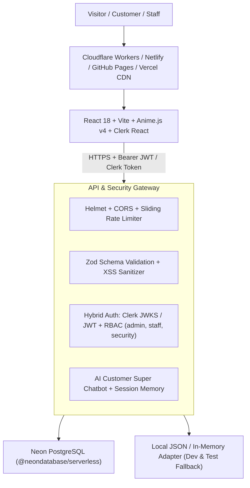

# System Architecture (`ARCHITECTURE.md`)

## High-Level Architecture

## Security & Isolation Boundaries
1. **Transport & Headers**: `helmet` enforces `X-Content-Type-Options: nosniff` and `X-Frame-Options`; CORS restricts origins to configured domains and deployed platforms.
2. **Authentication**: Requests to protected admin/staff/security endpoints must present a valid Clerk session JWT or signed application JWT.
3. **Validation**: Every `POST`/`PATCH` body is sanitized and validated by Zod before reaching database adapters.
4. **Persistence**: All Neon SQL queries use positional parameters (`$1, $2, ...`) to prevent SQL injection.
