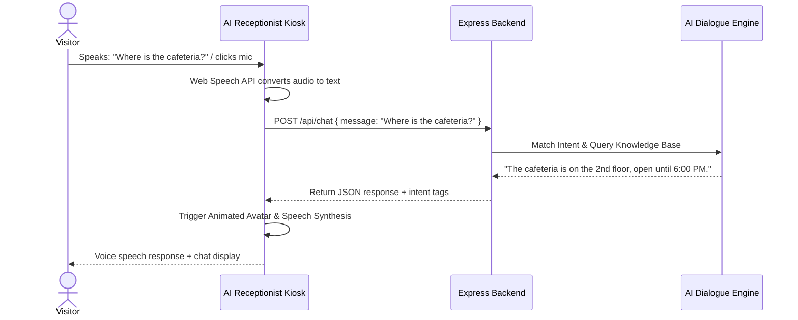
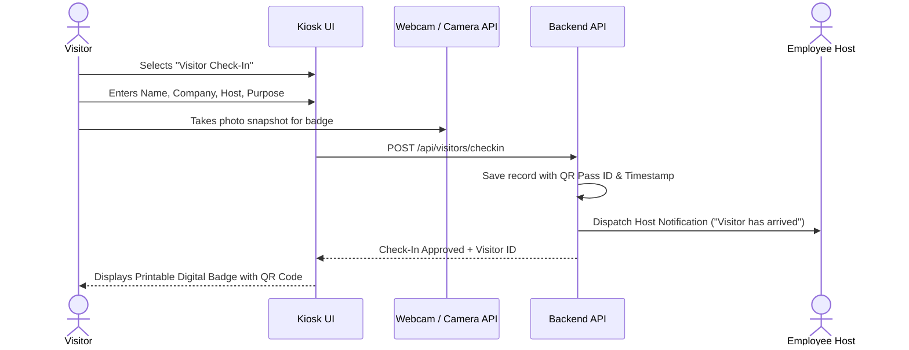
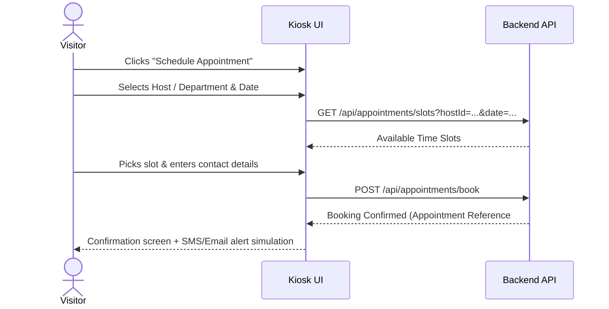

# AURA AI Receptionist System — Project Specification & Blueprint

---

## 1. Executive Summary & Product Vision
**AURA (Automated Unified Reception Assistant)** is an enterprise-grade multimodal AI Receptionist system designed to replace or assist front-desk staff in corporate offices, clinics, co-working spaces, and boutique organizations. 

AURA combines **voice-driven conversational AI**, **facial/webcam badge capture**, **express visitor check-in**, **self-service calendar appointment booking**, **host notification simulation**, and a **real-time administrative management portal** into a sleek, responsive, touch-and-voice enabled kiosk application.

---

## 2. Product Requirements Document (PRD)

### 2.1 Target Users & Personas
1. **Corporate Visitors & Clients**: Need quick check-in, host notification, Wi-Fi credentials, and guidance to meeting rooms without waiting in queues.
2. **Interview Candidates & Vendors**: Need to sign in, receive a digital visitor pass/badge, and wait comfortably with real-time status updates.
3. **Office Hosts / Employees**: Receive instant notifications when their visitor arrives, with the ability to acknowledge or send instructions ("Meet me in Room 302").
4. **Office Admin / Security Personnel**: Monitor live visitor headcounts, view booked appointments, issue emergency alerts, and manage directory contacts.

### 2.2 Core Feature Requirements
| Module | Feature | Description | Priority |
|---|---|---|---|
| **Voice & Multimodal AI** | Live Speech-to-Text & TTS | Real-time speech recognition and lifelike voice synthesis with animated avatar visualizer. | P0 |
| **Conversational Core** | Knowledge Base & FAQ Agent | Answers office questions (Wi-Fi, parking, cafeteria, restrooms, safety policies, directory). | P0 |
| **Visitor Management** | Express Check-In & Badge | Captures name, company, host, purpose, captures photo via webcam, and generates a printable badge with QR code. | P0 |
| **Scheduling** | Appointment Booking | Interactive time-slot selector for staff or meeting rooms with instant confirmation and conflict detection. | P0 |
| **Host Notification** | Real-time Alert Simulation | Dispatches notifications to host with response action ("On my way", "Direct to room"). | P0 |
| **Admin Dashboard** | Staff & Security Portal | Real-time visitor log, active on-site badge list, check-out terminal, calendar view, and analytics. | P0 |
| **Emergency / Safety** | One-Touch Protocol | Evacuation plan, emergency contacts, and one-click evacuation headcount roster. | P1 |

---

## 3. Technical Requirements Document (TRD / TRP)

### 3.1 Technology Stack Selection
- **Frontend**: 
  - Framework: Modern React (Vite) + Tailwind CSS + Lucide Icons + Canvas Audio Waveform Visualizer.
  - Speech Integration: Web Speech API (`SpeechRecognition` / `webkitSpeechRecognition` + `SpeechSynthesis`) for ultra-fast, zero-latency in-browser voice interaction.
  - Video/Camera: HTML5 `MediaDevices.getUserMedia` for live camera stream and photo snapshot capture for visitor badges.
  - Printable Output: Responsive HTML5/CSS Print & SVG QR code badge generator.
- **Backend**:
  - Runtime: Node.js (Express.js) REST API with WebSockets / SSE or real-time event dispatching.
  - Database: Lightweight, reliable JSON/file-based persistent storage (`lowdb` / atomic JSON store) with seeded demo staff, appointments, and knowledge base.
  - AI Engine: Hybrid architecture:
    - **Local Semantic Intent & Entity Parser** (Built-in offline/standalone fallback for instant out-of-the-box operation with zero external dependencies).
    - **LLM Extension Endpoint** (Supports Google Gemini / OpenAI API key injection for open-ended conversational intelligence).
- **Communication & Protocols**:
  - HTTP/REST JSON endpoints for CRUD operations (Visitors, Appointments, Directory, Host Notifications, Knowledge Base).

### 3.2 Non-Functional Requirements
- **Response Latency**: Voice feedback and speech synthesis starts within `< 500ms`.
- **Offline / Zero-Config Capability**: System runs completely without external API keys or cloud dependencies, while maintaining graceful upgrade if API keys are provided.
- **Security & Privacy**: Zero plain-text storage of credentials; visitors can check out anytime; automated data retention cleanup.
- **Accessibility**: Full keyboard and touch support with clear visual feedback states: `Idle`, `Listening`, `Thinking`, `Speaking`.

---

## 4. System Architecture

```
+-----------------------------------------------------------------------------------+
|                                  USER / VISITOR                                   |
|                (Voice Input, Touch Screen, Webcam Snapshot Capture)               |
+-----------------------------------------------------------------------------------+
                                          |
                                          v
+-----------------------------------------------------------------------------------+
|                             FRONTEND CLIENT (PORT 3000)                           |
|  +-----------------------------------------------------------------------------+  |
|  | KIOSK INTERFACE (Executive Dark/Glass Theme)                                |  |
|  | - Animated AI Avatar & Dynamic Waveform Visualizer                           |  |
|  | - Speech Recognition Engine (Mic) & Speech Synthesis (Voice Response)       |  |
|  | - Mode Switcher: AI Voice Chat | Express Check-In | Bookings | Admin Portal |  |
|  +-----------------------------------------------------------------------------+  |
|  | VISITOR BADGE MODULE                                                        |  |
|  | - Webcam Stream & Snapshot Handler                                          |  |
|  | - QR Code Pass Generator & Printable Badge Canvas                           |  |
|  +-----------------------------------------------------------------------------+  |
|  | ADMIN & HOST MANAGEMENT PORTAL                                              |  |
|  | - Live Visitor Log (Checked In / In Meeting / Checked Out)                  |  |
|  | - Host Notification Feed & Quick Reply Actions                              |  |
|  | - Appointment Calendar & Staff Directory Management                         |  |
+-----------------------------------------------------------------------------------+
                                          |
                           REST APIs / JSON over HTTP
                                          |
                                          v
+-----------------------------------------------------------------------------------+
|                              BACKEND SERVER (PORT 5000)                           |
|  +----------------------+ +-------------------------+ +-------------------------+  |
|  |   AI Dialogue &      | |  Visitor Check-In &     | |  Appointment & Room     |  |
|  |   Intent Engine      | |  Badge Controller       | |  Booking Manager        |  |
|  +----------------------+ +-------------------------+ +-------------------------+  |
|  |   Staff Directory &  | |  Host Notification Hub  | |  Analytics & Emergency  |  |
|  |   Availability API   | |  (Simulated Dispatch)   | |  Evacuation System      |  |
|  +----------------------+ +-------------------------+ +-------------------------+  |
+-----------------------------------------------------------------------------------+
                                          |
                                          v
+-----------------------------------------------------------------------------------+
|                        LOCAL DATA PERSISTENCE LAYER                               |
|          `visitors.json` | `appointments.json` | `directory.json` | `faq.json`    |
+-----------------------------------------------------------------------------------+
```

---

## 5. Visual Flow & User Journeys

### 5.1 Voice Interaction & FAQ Inquiry


### 5.2 Visitor Check-In & Badge Generation


### 5.3 Appointment Scheduling


---

## 6. Implementation Steps & Execution Plan

1. **Step 1: Workspace Initialization**
   - Create project structure: `backend/` and `frontend/`.
   - Initialize package manifests and dependencies.

2. **Step 2: Backend Development (Node.js/Express)**
   - Create REST APIs for:
     - `/api/chat` (Conversational AI with NLP intent classifier and FAQ knowledge base).
     - `/api/visitors` (Check-in, check-out, live visitors list, badge generation).
     - `/api/appointments` (Slot availability, booking, cancel, list).
     - `/api/directory` (Staff list, status, department search).
     - `/api/notifications` (Host alerts dispatch and acknowledgement).
     - `/api/analytics` (Today's statistics, visitor count, peak hours).
   - Implement file-backed data store with rich seed data.

3. **Step 3: Frontend Development (React + Tailwind CSS)**
   - **Kiosk Mode**:
     - Animated 3D/Pulse AI Avatar visualizer with dynamic audio reaction.
     - Dual input: Voice microphone recognition + on-screen touch/keyboard.
     - Express Check-In Modal with live webcam photo capture and instant badge preview.
     - Appointment Booking Modal with interactive slot picker.
     - Interactive FAQ & Office Directory search with click-to-ask.
   - **Staff & Admin Dashboard**:
     - Real-time visitor log with one-click check-out.
     - Host notification center with simulated 2-way replies.
     - Appointment calendar view.
     - Emergency muster roll / evacuation roster export.

4. **Step 4: End-to-End Verification & Testing**
   - Test speech synthesis and speech recognition fallback.
   - Test visitor check-in, photo snapshot, badge rendering.
   - Test appointment booking and conflict prevention.
   - Test host notifications and admin check-out flow.

5. **Step 5: Handover and Documentation**
   - Provide run scripts, step-by-step instructions, and usage guide.

---

## 7. How to Execute the Project

### Prerequisites
- Node.js v18+ (verified installed: v26.13.1)
- Modern web browser (Chrome, Edge, Firefox, Brave) with microphone and camera support.

### One-Command Quickstart
```bash
# From the project root:
npm run start
# Or start backend and frontend concurrently:
# Backend on http://localhost:5000
# Frontend on http://localhost:3000
```
